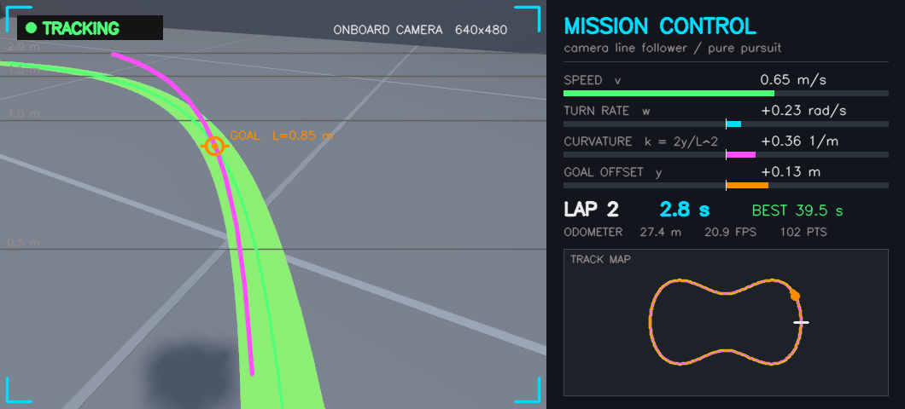

# line_follower_sim

A camera-guided line-following robot in **Gazebo Harmonic**, built on **ROS 2 Jazzy**, steered by **pure pursuit**.



**New here? Read [How it works](docs/HOW_IT_WORKS.md)** for the full explanation: perception, camera geometry, pure pursuit, the state machine, and how it maps to digital logic.

## Run

```bash
cd ~/ros2_ws && colcon build --symlink-install
source ~/ros2_ws/install/setup.bash
ros2 launch line_follower_sim sim.launch.py              # Gazebo + dashboard
ros2 launch line_follower_sim sim.launch.py chase_cam:=true   # Gazebo camera follows the robot
```

## How it works

| Stage | What happens |
|---|---|
| Sense | A 640×480 camera, mounted 0.30 m high and pitched 34° down, streams `/camera/image_raw` at 30 Hz through `ros_gz_bridge`. |
| Perceive | The yellow line is thresholded in HSV colour space and tracked row by row from the bottom of the image upward. |
| Project | Each line pixel is projected onto the floor using the pinhole camera model and the known mounting, giving points in metres in the robot frame. |
| Plan | **Pure pursuit** picks the line point at lookahead distance L = 0.85 m and computes the arc through it: curvature κ = 2y / L². |
| Act | Turn rate ω = v·κ, with speed v reduced on tight bends, published as `geometry_msgs/Twist` on `/cmd_vel` to Gazebo's diff-drive plugin. |

Measured in simulation: mean distance from the line is 2.9 cm (max 5.5 cm), and a lap of the 26 m track takes about 40 s.

## Files

- `line_follower_sim/follower.py`: perception, pure pursuit, and the mission-control dashboard
- `line_follower_sim/track.py`: the track's shape, shared by the world generator and the minimap
- `tools/make_world.py`: generates `worlds/line_track.sdf` (arena, race line, start gate, barrels, robot)
- `launch/sim.launch.py`: starts Gazebo, the bridge, and the follower
- `config/gui.config`: Gazebo window layout and starting camera angle
