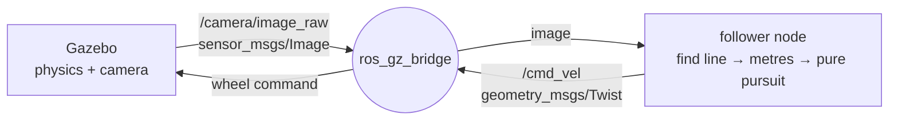
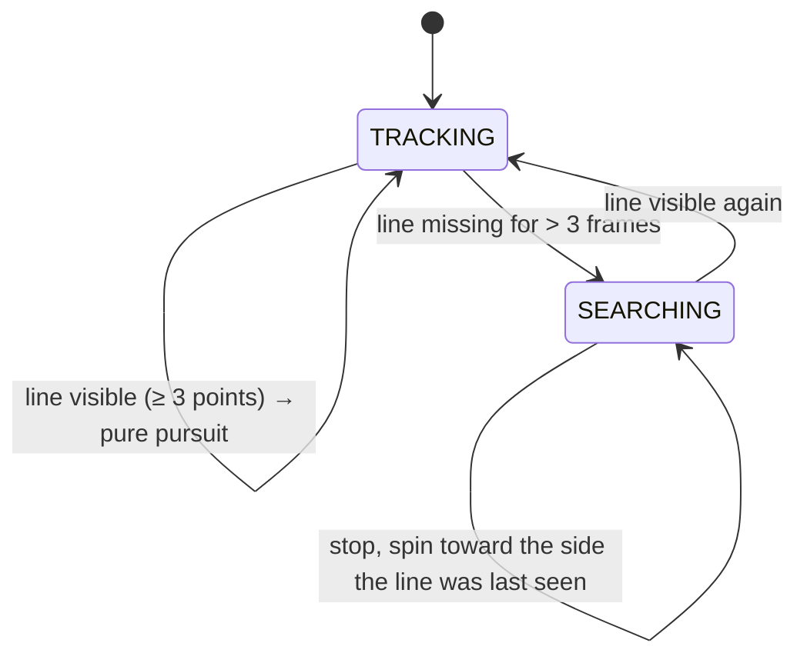

# How the line follower works

The robot runs one loop, about 30 times a second: **sense → think → act**.



The camera sees the line, the follower node decides how to steer, the wheels turn, the robot moves, and the camera sees something new. Because the output feeds back into the input, this is a **closed-loop control system**.

---

## 1. The world: Gazebo and SDF

Gazebo is a physics simulator. Worlds and robots are described in **SDF**, an XML format. `tools/make_world.py` writes `worlds/line_track.sdf` for us.

- **The race line** is about 520 short yellow boxes, each 5 cm long and 7 cm wide, laid end to end along this curve:

  x = 4.3 cos t + 0.35 cos 3t  y = 2.7 sin t + 0.95 sin 3t

  The `sin 3t` term pinches the long sides inward, which creates the S-bends. The line is 26 m long, and its tightest bend has a radius of 1.41 m. The material is *emissive* (it glows), so shadows don't change its colour.
- **The robot**:
  - a 36 × 24 cm chassis
  - two driven wheels (radius 5 cm, 32 cm apart) on revolute joints
  - two frictionless caster balls for balance
  - a camera on a mast, 30 cm above the floor, tilted 34° down
- **Gazebo plugins**, small programs that add behaviour:

  | Plugin | Job |
  |---|---|
  | `DiffDrive` | Listens on `cmd_vel` and spins the two wheels to produce that motion |
  | `Sensors` | Renders the camera image with the OGRE 2 graphics engine |
  | `OdometryPublisher` | Publishes the robot's exact position (ground truth) for the minimap |
  | `Physics` | Gravity, friction, collisions |

## 2. The bridge

Gazebo and ROS 2 each have their own messaging system. `ros_gz_bridge` translates between them:

| Topic | Direction | Message | Used for |
|---|---|---|---|
| `/camera/image_raw` | Gazebo → ROS | `sensor_msgs/Image` | what the robot sees |
| `/cmd_vel` | ROS → Gazebo | `geometry_msgs/Twist` | speed and turn commands |
| `/ground_truth` | Gazebo → ROS | `nav_msgs/Odometry` | exact pose, for the minimap and laps |
| `/odom` | Gazebo → ROS | `nav_msgs/Odometry` | wheel odometry (drifts, kept for comparison) |
| `/clock` | Gazebo → ROS | `rosgraph_msgs/Clock` | simulation time, for the lap timer |

## 3. Perception: finding the line in the image

All of this happens in `follower.py`, in `on_image()` and `find_line()`.

1. **Convert BGR → HSV.** HSV splits colour into **H**ue (which colour), **S**aturation (how vivid) and **V**alue (how bright). A shadow changes V but barely changes H, so testing hue is robust to lighting.
2. **Threshold.** A pixel counts as line when
   `18 ≤ H ≤ 40  AND  S ≥ 80  AND  V ≥ 80`
   (OpenCV measures hue from 0 to 180, and yellow sits around 30). The result is a **binary mask**: 1 for line, 0 for everything else.
3. **Clean up.** A *morphological opening* (erode, then dilate, with a 3×3 window) deletes isolated noise pixels.
4. **Scan rows from the bottom up**, every 4th row:
   - Find the runs of 1-pixels in the row and take each run's centre.
   - Keep the run closest to the previous row's centre. This follows the line upward and ignores other parts of the track visible in the distance.
   - Ignore any jump bigger than 70 px.

The output is a chain of pixel points along the line, nearest first.

## 4. From pixels to metres (inverse perspective mapping)

Pure pursuit needs real distances on the floor, not pixels. A pixel near the top of the image covers much more floor than one near the bottom. Because we know exactly where the camera is, each pixel can be projected onto the floor (`GroundCamera.pixel_to_ground`):

- Camera height h = 0.30 m, tilt φ = 0.6 rad (34°), mounted 0.17 m ahead of the wheel axle
- Field of view 1.4 rad (80°) across 640 px, so the focal length is f = 320 / tan(0.7) ≈ 380 px

For pixel (u, v):

```
a = (u − 320) / f          b = (v − 240) / f
ray (robot frame) = ( cos φ − b sin φ ,  −a ,  −sin φ − b cos φ )
t = h / (sin φ + b cos φ)                      ← where the ray hits the floor
floor point = ( 0.17 + t·(cos φ − b sin φ) ,  −t·a )
```

**Worked example:** the bottom-centre pixel (u = 320, v = 477) gives b = 0.624, t = 0.278, and a floor point x = 0.30 m, y = 0. So the bottom edge of the image sees the floor 30 cm ahead of the axle. Rays at or above the horizon never reach the floor, so they're skipped, and only points up to 2.6 m ahead are used.

The dashboard runs this in reverse (`ground_to_pixel`) to draw the planned arc and the distance lines back onto the camera image.

## 5. Steering: pure pursuit

Pure pursuit was described by R. Craig Coulter at Carnegie Mellon in 1992, for self-driving vehicles.

1. Walk along the floor points until one is **L = 0.85 m** away. Interpolate between neighbouring points to get the exact spot. This is the **goal point (x, y)**, with y measured to the left.
2. Find the circle that starts at the robot, points the way the robot points, and passes through the goal. With the robot at the origin facing +x, that circle's centre is at (0, R):

   ```
   x² + (y − R)² = R²   →   x² + y² = 2yR   →   R = L² / 2y
   curvature  κ = 1/R = 2y / L²
   ```
3. A robot moving at speed v along a circle of curvature κ turns at **ω = v · κ**.
4. **Speed control:** slow down when the turn ahead is sharp:
   `v_target = 1.0 / (1 + 1.6 · max(|κ|, 0.6 |κ_far|))`, clamped to 0.4–1.0 m/s and smoothed by 20% per frame. Here κ_far is the curvature toward the farthest visible point, so the robot starts braking *before* a bend.
5. Publish `linear.x = v`, `angular.z = ω` (limited to ±2.5 rad/s). The DiffDrive plugin turns that into wheel speeds:
   `v_right = v + ω·b/2`, `v_left = v − ω·b/2`, where b = 0.32 m is the distance between the wheels.

**Why a lookahead distance?** A short L reacts fast but wobbles. A long L is smooth but cuts corners. At 0.85 m the robot stays within a few centimetres of the line at up to 1 m/s.

## 6. The state machine



If the line disappears for a frame or two, the robot keeps its last command, which acts as a small noise filter. If it's gone for longer, the robot stops and spins toward where it last saw the line.

## 7. The dashboard

- **Camera panel:**
  - detected line pixels tinted cyan
  - the tracked centre-line in green
  - the planned arc in magenta (the steering circle, projected back into the image)
  - the goal point in orange
  - distance lines at 0.5, 1.0, 1.5 and 2.0 m
- **Telemetry bars:** speed v, turn rate ω, curvature κ, goal offset y.
- **Laps:** a lap counts when the robot passes within 0.35 m of the start after travelling at least 15 m. Times use simulation time.
- **Minimap:** the track shape (from `track.py`) plus the robot's path from ground truth.

## 8. Connection to Digital Logic Design

| In this robot | DLD concept |
|---|---|
| The HSV threshold turns every pixel into a 1 or a 0 | Digitisation: a comparator turning an analog level into a logic level |
| `18 ≤ H ≤ 40 AND S ≥ 80 AND V ≥ 80` | Four magnitude comparators feeding a 4-input **AND gate** |
| Erosion: a pixel stays 1 only if all 9 pixels in its 3×3 window are 1 | A 9-input **AND** |
| Dilation: a pixel becomes 1 if any pixel in its window is 1 | A 9-input **OR** |
| TRACKING / SEARCHING | A **finite state machine** (Moore type: the output depends on the state) |
| "Line missing for more than 3 frames" | A **counter** with a compare-and-reset |
| Lap counter, best lap time | Event **counter**, plus comparator and **register** |
| Everything updates once per camera frame (30 Hz) | A **synchronous, clocked** system |

**The simplest version, as you'd build it with an Arduino:** two infrared sensors, each outputting 1 when it is over the line:

| Left | Right | Action |
|:-:|:-:|---|
| 0 | 0 | line is between the sensors → go straight |
| 1 | 0 | line drifting left → turn left |
| 0 | 1 | line drifting right → turn right |
| 1 | 1 | junction or stop line → stop |

That truth table is pure combinational logic, giving only **bang-bang** steering (full left, straight, or full right). This project replaces the two sensors with a camera that sees 2.6 m ahead, so it can steer smoothly along a calculated arc instead of zig-zagging.

## 9. Results (measured in simulation)

- Mean distance from the line: **2.9 cm**. Maximum: **5.5 cm**. The line itself is 7 cm wide.
- Lap time on the 26 m track: about **40 s**, with top speed 1.0 m/s and automatic braking for bends.
- Measured with a monitor node comparing Gazebo's ground-truth pose to the track geometry.
